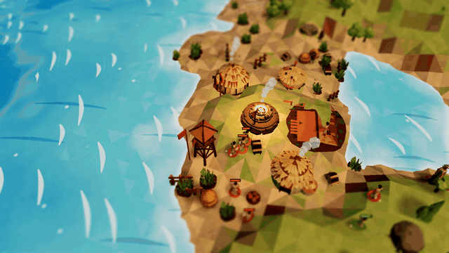
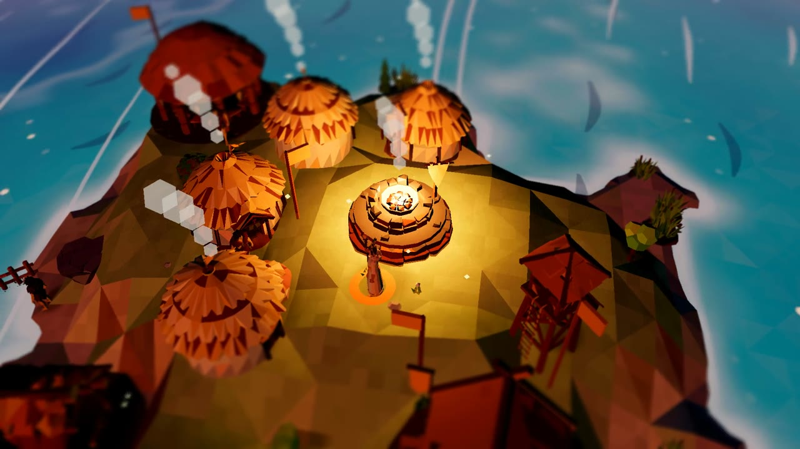
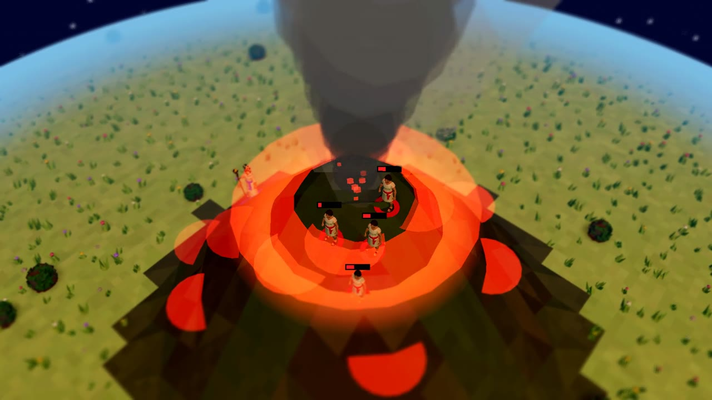
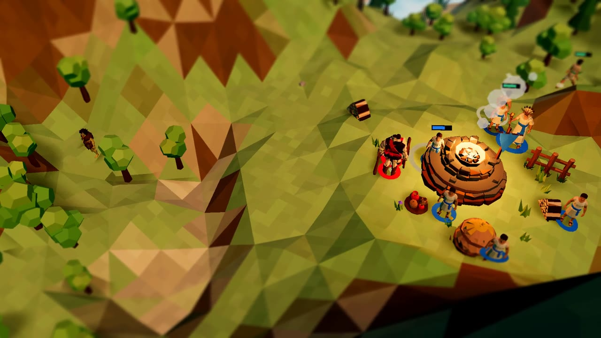
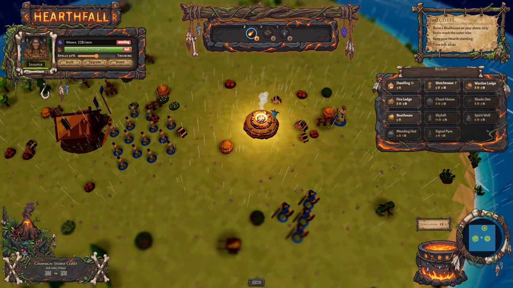
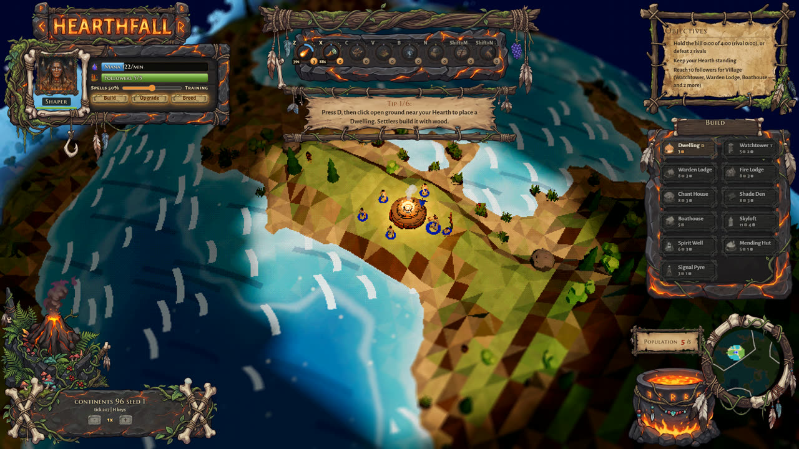
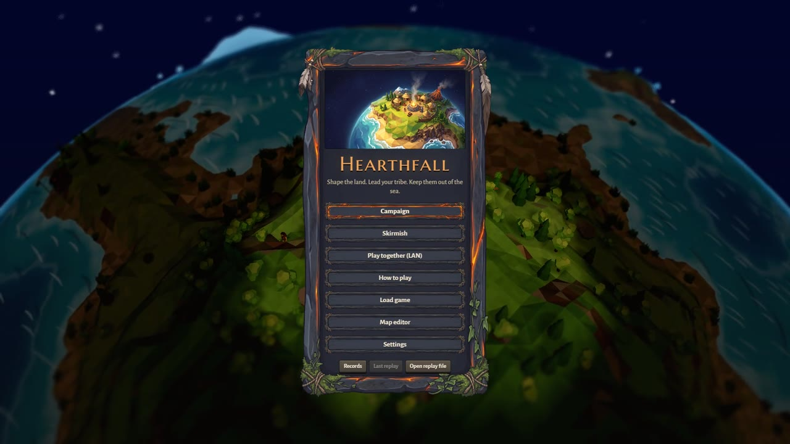

# Hearthfall


A 3D god game on a tiny wrapping planet: prayers are your power, the land is your weapon, and the sea is not your friend.



**[Landing page](https://hearthfall-4wn.pages.dev)** · **[Play in your browser](https://hearthfall.stewartgregerson.workers.dev/)** · **[How it was made](https://hearthfall-4wn.pages.dev/#made)**

## What it is

You are the Shaper, a mortal caster who leads a tribe out from its Hearth. Settlers gather wood and raise huts, followers pray at the Hearth and at hill shrines, and every prayer becomes mana for spells that move the land: raise a bridge across a strait, sink the ground under an army, crack a village with a quake or call a volcano out of a meadow. Water kills, so the terrain is the real weapon. Rival tribes with their own personalities (aggressive, sneaky, turtle) build, worship across the sea by boat and balloon, and come for your Hearth.

It ships a 45 level campaign in four chapters, skirmish with victory variants, a Forge phase where every tribe shapes the map before the match, a map editor, replays, photo mode, achievements, and LAN play (versus, co-op and the campaign together). It is an original game inspired by the tribal god games of the late 1990s and is not affiliated with any of them.

Status: **in development**. The whole game is playable from the first level to the last, and it is still growing (chapter 4 has only been played by the level bots so far; the live build predates it).

## Screenshots

| | |
|---|---|
|  |  |
|  |  |
|  |  |

## How it was made

Hearthfall was built by [Claude Code](https://claude.com/claude-code) working autonomously for days at a time. Stewart Gregerson wrote a kickoff package (design intent, a twelve milestone roadmap with gates that pass by command, testing rules and asset budgets; it is kept in [docs/KICKOFF.md](docs/KICKOFF.md) and [OPENING_PROMPT.md](OPENING_PROMPT.md)) and then acted as director: he chose between art directions, played builds and sent notes, and the agent made every other call and recorded it in [docs/DECISIONS.md](docs/DECISIONS.md). The first run went from an empty folder to all twelve milestones in about 26 hours; the game kept growing for a week after that.

- **Stack:** TypeScript, three.js r186 (WebGL2) with a curved-world vertex bend, Preact for the interface, Vite, Vitest and Playwright. No game engine.
- **Deterministic simulation:** `packages/sim` runs on fixed ticks with seeded randomness and an allowlist of math functions, enforced by a guard in `npm run check`. Replays are exact, two browsers stay in lockstep on a LAN, and a scripted bot proves every campaign level winnable (91 level scenarios: a bot that wins and an idle player who loses).
- **Data first:** units, buildings, spells, AI personalities and all 45 levels are validated JSON in `data/` (schemas in [docs/DATA.md](docs/DATA.md)), and mods in `mods/` change the game without code.
- **Screenshot QA:** 668 unit tests, golden replays in Node and Chromium, render benches and 13 sets of screenshot baselines captured on the GPU headless, with an AI vision check (OpenAI) that reads screenshots for layout problems.
- **Generated assets:** Gemini painted concepts, icons, spell textures, interface pieces and the key art; Meshy turned the concepts into low-poly 3D models; ElevenLabs made the sound effects, voices and music; a Blender script normalizes every model and snaps it to one palette. The pipeline lives in `tools/assets/` with hard per-provider budgets and a cost ledger.
- **Media:** the landing page clips are captured by script (`tools/showcase/film.mjs`): the game runs on a virtual clock and is filmed one frame at a time while the AI tribes play themselves, then reviewed by Gemini (`tools/showcase/review.mjs`).

The making-of archive in [making-of/](making-of/) keeps every milestone screenshot, contact sheet and concept image from first pixels onward, and [docs/PROGRESS_LOG.md](docs/PROGRESS_LOG.md) is the full development log.

## Run it locally

Needs Node.js 22.18 or newer and a desktop browser with WebGL2.

```
npm install
npm run build
npm run serve
```

`npm run serve` serves the production build and prints the local address. `npm run qa:fast` runs the quick checks (types, guards, unit tests); the full suite is `npm run qa` (see [docs/TESTING.md](docs/TESTING.md)). The asset pipeline needs API keys in a local `.env` (names in `.env.example`); the game itself needs none.

## Credits

| What | Who | Licence |
|---|---|---|
| Code, design docs, data and levels | Claude Code, directed by Stewart Gregerson | MIT (see [LICENSE](LICENSE)) |
| 3D models (buildings, units, wildlife, props, vehicles) | Generated for this project with [Meshy](https://www.meshy.ai) from Gemini concepts, normalized in Blender | Generated output, used under the [Meshy Terms of Service](https://www.meshy.ai/terms-of-use) |
| Concept art, icons, spell textures, painted interface pieces, title key art | Generated for this project with [Google Gemini](https://ai.google.dev) image models | Generated output, used under the [Gemini API Additional Terms](https://ai.google.dev/gemini-api/terms) |
| Sound effects, voices, music | Generated for this project with [ElevenLabs](https://elevenlabs.io) (sound generation, voice design, music) | Generated output, used under the [ElevenLabs Terms of Service](https://elevenlabs.io/terms-of-use) |
| Marcellus SC font | Brian J. Bonislawsky (Astigmatic), via [Fontsource](https://fontsource.org) | [SIL Open Font License 1.1](https://openfontlicense.org) |
| Alegreya Sans and Alegreya Sans SC fonts | Juan Pablo del Peral (Huerta Tipográfica), via Fontsource | SIL Open Font License 1.1 |
| three.js, Preact, Vite and the other npm dependencies | Their authors | Their own licences (mostly MIT), see `package.json` |
| Screenshot review | OpenAI (VisionQA) and Google Gemini (landing clips) | Review only: no output ships in the game |

No third-party asset packs are used, and no assets or names from any existing game.

## Licence

Code is MIT (see [LICENSE](LICENSE)). Third-party assets listed above keep their own licences.
